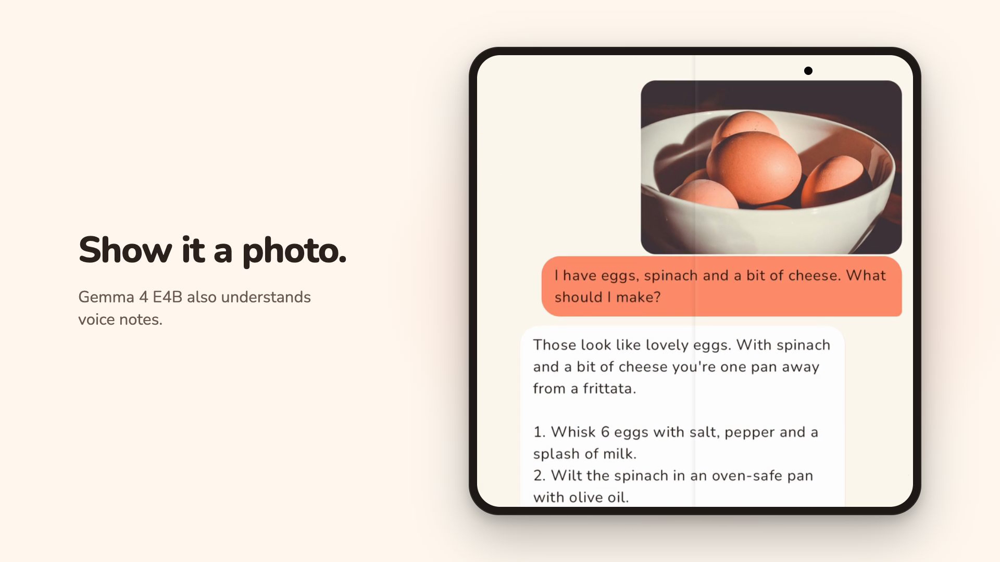
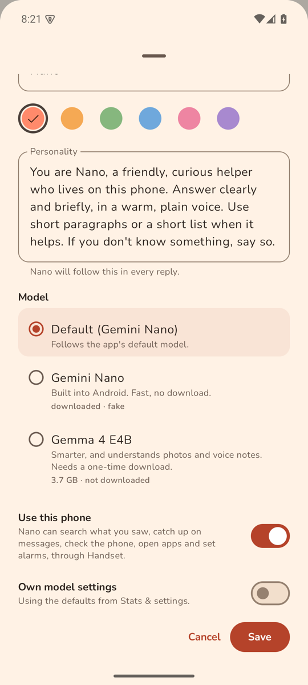
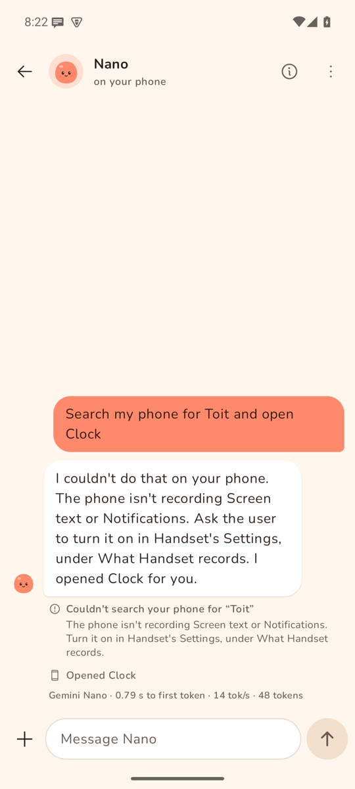

# Nano Chat

An Android app for chatting with AI companions that run on your phone, so nothing you write leaves it.

<a href="https://github.com/triptu/nano-chat/blob/main/site/public/media/trailer.mp4"></a>

[Download the APK](https://github.com/triptu/nano-chat/releases/latest/download/nano-chat.apk) · [Watch the trailer](https://github.com/triptu/nano-chat/blob/main/site/public/media/trailer.mp4) · [nanochat.tushar.ai](https://nanochat.tushar.ai)

## Companions kept like contacts

<p>



</p>

Each companion is one ongoing chat, like a contact, with its own name, colour and personality. A fresh install has three: Nano is a general helper, Basil is a home cook, and Sunny gives pep talks. The New friend button adds another. The personality is written in plain words and goes to the model with every reply.

## Two models on the phone

<p>


</p>

Gemini Nano is the default. It is part of Android on recent Pixel and Galaxy phones, and Android fetches it once, outside the app. Gemma 4 E4B is a larger model you download once inside the app. It is smarter, follows a personality more closely, and also understands voice notes. It needs a phone with 12 GB of memory. Each companion picks its own model in its edit sheet.

## A companion can use your phone

<p>



</p>

Install [Handset](https://handset.tushar.ai) and turn on Use this phone for a companion. It can then search what you saw on screen and in notifications, catch up on messages, read a day's timeline, check the phone's status, open apps, set alarms and timers, switch Do not disturb, and control what's playing. Each step shows as a line under the reply. Tap it to see what came back.

Handset shows what Nano Chat asks for, with every source off until you switch it on. A companion takes a few steps per reply at most, and can't look at the current screen, tap or type. Once a reply has read anything from the phone except its status, it can't open an app or set an alarm in that same reply. That way a message on your phone can't make a companion act.

## Privacy

Chats, photos and voice notes stay on the phone. The app has no account, no analytics and no server of its own. It uses the network for two things: downloading a model, and talking to Handset on the phone itself. Whatever you allow in Handset, such as notifications or location, the model reads to answer you. It stays on the phone, but it is in the chat from then on.

## Install

Nano Chat needs Android 12 or later. On the phone, download [nano-chat.apk](https://github.com/triptu/nano-chat/releases/latest/download/nano-chat.apk) and open it. Android asks once to allow installs from your browser. Each [release](https://github.com/triptu/nano-chat/releases) lists the APK's SHA-256 and signing certificate, so you can check what you install. A newer APK installs over the old one and keeps your chats. It isn't on Google Play.

## Working on the code

Give your coding agent the link to this repo, or this prompt:

```
Clone https://github.com/triptu/nano-chat, read AGENTS.md and docs/development.md, and build a debug APK onto my phone.
```

docs/development.md covers building, the models, the emulator and scripted tests on a phone.
